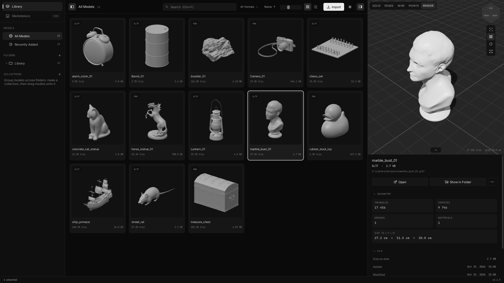
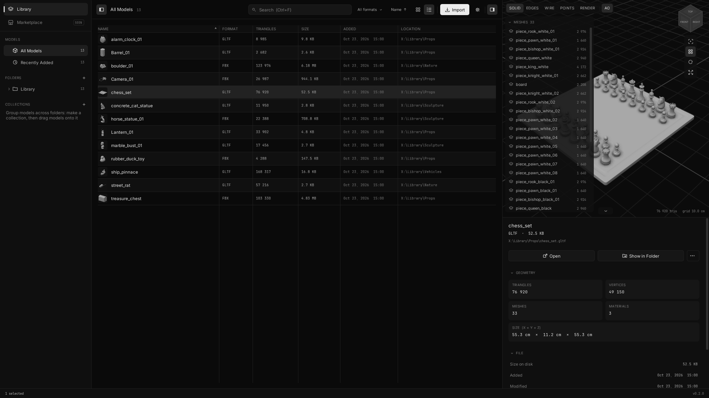
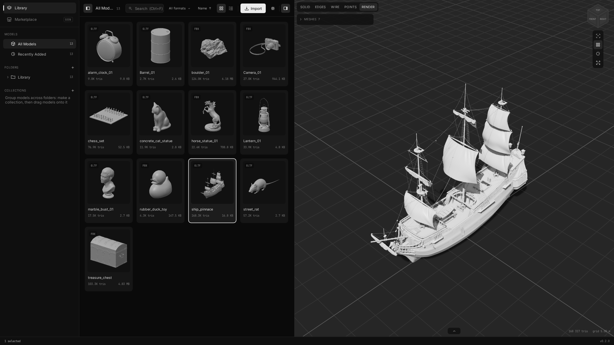

# Creative Cell

A fast, native 3D asset library and viewer for Windows. Point it at the
folders where your models live — FBX, OBJ, glTF / GLB, STL — and it builds a
searchable library with thumbnails, without moving or copying a single file.

- **Library.** Folders are indexed in place, with their subfolders; new,
  changed and missing files are picked up on rescan. Collections group models
  across folders.
- **Find things quickly.** Search by name and path, filter by format, sort by
  date, name, file size or triangle count; tiles or a table.
- **Inspector.** A 3D view of the selected model — Solid, Edges, Wire, Points
  and Render (a sun with soft shadows on the model and the floor, sky light,
  ambient occlusion) — with a navigation cube, a floor grid, a turntable and
  an outliner of the model's meshes. Triangles, vertices, meshes, materials,
  real-world size, dates.
- **Works with your tools.** Drag models out of the window into Blender,
  Unreal, Unity or Explorer. Double-click opens a file in its default app.
- **Explorer.** 3D files get thumbnails in Explorer and open in Creative Cell's
  viewer, as tabs in one window, without being added to the library.
- **Fast and light.** One small exe, no server or browser: C++ with OpenGL.
  Big files load in the background and stream from the disk; nothing is
  redrawn while nothing changes.

## Download

The installer is on the [Releases](../../releases) page (Windows 10 / 11, 64-bit).

---

**Creative Cell** — нативная библиотека и просмотрщик 3D-моделей для Windows.
Укажите папки с моделями (FBX, OBJ, glTF / GLB, STL) — программа соберёт
библиотеку с превью, поиском и фильтрами, ничего не перемещая и не копируя.
3D-инспектор с режимами Solid / Edges / Wire / Points / Render, мягкими тенями
и AO, аутлайнером мешей; перетаскивание моделей в Blender, Unreal, Unity;
миниатюры и просмотр 3D-файлов прямо из проводника.

---

© 2026 Mike Hargest. All rights reserved — the source is published for reading
only, see [LICENSE](LICENSE). Third-party software:
[THIRD_PARTY_LICENSES.txt](THIRD_PARTY_LICENSES.txt). Models in the
screenshots: [Poly Haven](https://polyhaven.com) (CC0).
